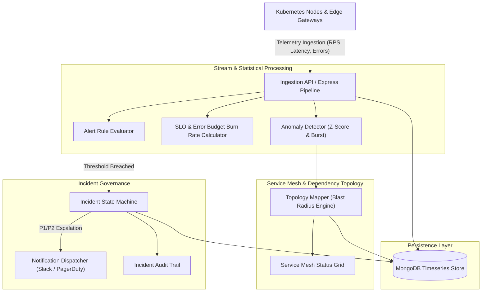

# 🛰️ CloudOps-Pulse — Distributed Microservices Telemetry, Service Mesh Observability & Incident Escalation Platform

[](https://nodejs.org)
[](https://expressjs.com)
[](https://mongodb.com)
[](https://reactjs.org)
[](https://docker.com)
[](https://opensource.org/licenses/MIT)

**CloudOps-Pulse** is an enterprise site reliability engineering (SRE) and observability platform designed to monitor distributed microservices architectures. It synthesizes the four Golden Signals (Latency, Traffic, Errors, Saturation), computes real-time Service Level Objective (SLO) error budgets, detects statistical anomalies over sliding time windows, and coordinates automated incident escalation with PagerDuty and Slack webhooks.

---

## 🏛️ System Architecture



---

## ✨ Core Engineering Highlights

1. **Four Golden Signals Synthesis**
   - Continuously ingests request throughput (RPS), P50/P95/P99 latency distribution, error rates, and CPU/memory saturation metrics.
   - Computes weighted health scores across microservice dependencies.

2. **SLO & Error Budget Management**
   - Implements Google SRE standard Service Level Indicators (SLI) and Service Level Objectives (SLO, e.g. 99.9%).
   - Calculates real-time remaining error budget in minutes/requests with proactive burn rate alerts.

3. **Directed Topology & Blast Radius Analysis**
   - Traverses microservice dependency graphs to identify downstream cascading failure risks before outages spread.
   - Prevents circular dependency deadlocks and visualizes upstream bottleneck nodes.

4. **Incident Lifecycle State Machine**
   - Governs incident triage through a strict 6-state workflow: `TRIGGERED` -> `ACKNOWLEDGED` -> `INVESTIGATING` -> `MITIGATED` -> `RESOLVED` -> `CLOSED`.
   - Immutable audit trail tracking MTTA (Mean Time to Acknowledge) and MTTR (Mean Time to Resolve).

5. **Multi-Channel Notification Dispatcher**
   - Dispatches formatted incident alerts to Slack channels and PagerDuty endpoints with cryptographic HMAC validation and exponential retry backoff.

---

## 🧪 Automated Test Suite

CloudOps-Pulse includes comprehensive automated tests built using Node.js native test runner:

```bash
# Execute test suites
npm test

# Run tests with code coverage analysis
npm run test:coverage
```

### Test Coverage Highlights
- `server/tests/anomalyDetector.test.js` — Z-score deviation evaluation and sudden latency burst detection.
- `server/tests/sloCalculator.test.js` — Error budget consumption formulas and 99.9% SLO compliance calculations.
- `server/tests/incidentStateMachine.test.js` — State machine transition validations and invalid transition guards.
- `server/tests/topologyMapper.test.js` — Blast radius identification and downstream dependency traversal.
- `server/tests/notificationDispatcher.test.js` — PagerDuty/Slack payload formatting and HMAC signature checks.
- `server/tests/goldenSignals.test.js` — Latency percentile aggregation and traffic weighting math.
- `server/tests/e2eIncidentLifecycle.test.js` — Complete lifecycle: Telemetry degradation -> P1 incident -> Acknowledge -> Mitigate -> Resolve.

---

## 🚀 Quickstart & Installation

```bash
# 1. Clone repository
git clone https://github.com/developertdsl-prog/cloudops-pulse.git
cd cloudops-pulse

# 2. Install dependencies
npm install
cd client && npm install && cd ..

# 3. Configure environment
cp .env.example .env

# 4. Seed microservices catalog and historical telemetry
npm run seed

# 5. Start API development server
npm run dev
```

---

## 📄 License
Licensed under the [MIT License](LICENSE). Designed & Maintained by `developertdsl-prog` (<developer.tdsl@gmail.com>).
